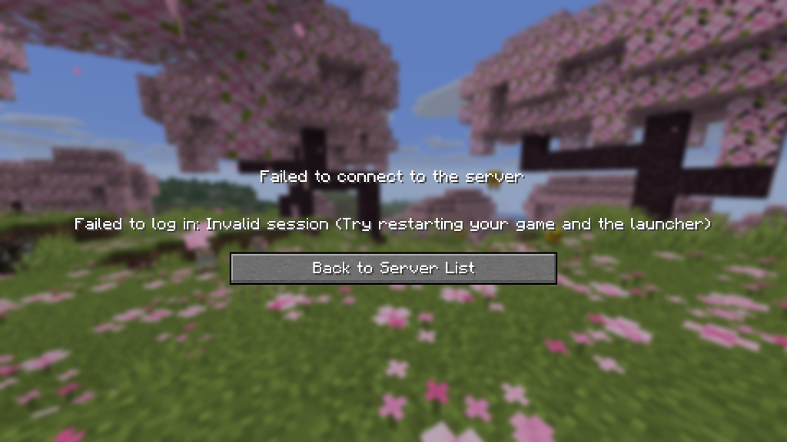
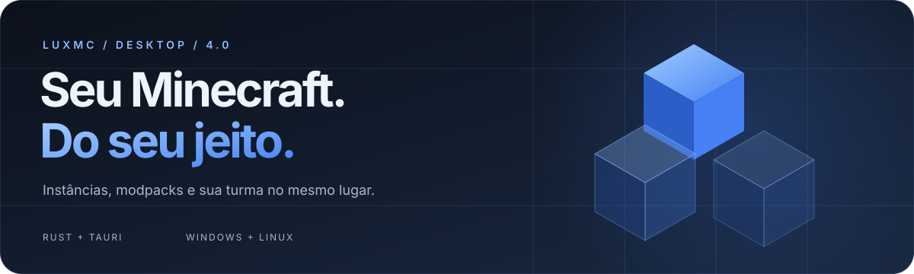
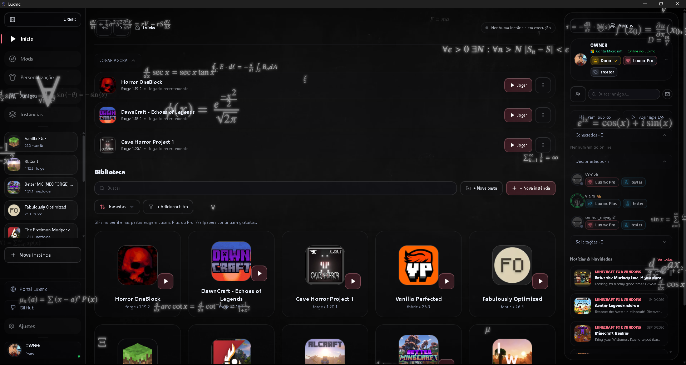
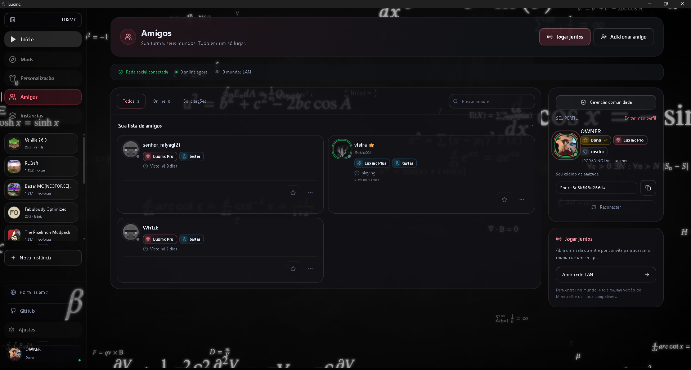

<div align="center">
  
  <h1>Luxmc 4.0 — Do Seu Jeito</h1>
  <p>Seu Minecraft, suas instâncias e sua turma.</p>
  <p><a href="https://luxmc-r92.pages.dev">Site oficial</a> · <a href="https://github.com/predabr/luxmc/releases/latest">Downloads</a> · <a href="SECURITY.md">Segurança</a></p>
</div>



<p align="center">
  <a href="https://github.com/predabr/luxmc/releases/latest"></a>
  <a href="LICENSE"></a>
  
</p>

Luxmc reúne versões Java, modpacks, organização de instâncias, personalização e recursos sociais. O backend usa Rust e Tauri 2; a interface usa Svelte 5 e TypeScript. O projeto tem raízes no Linux e instalador nativo para Windows.

**Versão atual: 4.0.0.** As correções da linha 4.0 recebem uma identificação própria de build. O código em `main` pode conter mudanças ainda não incluídas nos instaladores públicos; confira a [última release publicada](https://github.com/predabr/luxmc/releases/latest) antes de baixar.

**Licenciamento:** a [proposta de licença própria não comercial 2.0](docs/licensing/proposed/LUXMC-NONCOMMERCIAL-2.0-DRAFT.md) está publicada para revisão. Ela ainda não substitui a GPL vigente; veja o [status e o plano de adoção](docs/licensing/proposed/README.md).

## Escolha seu próximo mundo

| Para você | No Luxmc |
| --- | --- |
| Separar suas aventuras | Instâncias com mods, mundos e configurações próprios; pastas para organizar a biblioteca. |
| Descobrir conteúdo | Modrinth e CurseForge, importação de pacotes, filtros por Minecraft e loader e histórico de versões. |
| Ajustar cada modpack | Java, memória, resolução e argumentos por instância; ferramentas de reparo e diagnóstico. |
| Deixar com a sua cara | Temas, wallpapers locais, skins e prévia do perfil. Plus e Pro ampliam a personalização. |
| Reunir a turma | Amigos, convites e salas Java por túnel criptografado, com alternativa por endereço direto. |
| Controlar o movimento | Transições curtas, opções de animação, movimento reduzido e modo de desempenho. |

[Baixar](#instalação) · [Recursos da 4.0](#revisão-40) · [Amigos e aparência](#amigos-e-aparência) · [Desenvolvimento](#desenvolvimento) · [Licença](#licença-e-identidade)

## Instalação

- **Windows:** [instalador oficial](https://luxmc-r92.pages.dev/download/windows).
- **Linux:** escolha AppImage, DEB, RPM ou pacote Arch nas [releases](https://github.com/predabr/luxmc/releases/latest). Use o formato correspondente à sua distribuição.
- **macOS:** consulte os artefatos da release. A disponibilidade de um pacote não equivale a uma validação de todas as funções naquele sistema.

Baixe apenas dos canais oficiais. O atualizador verifica o manifesto assinado e o hash do arquivo antes de executar uma atualização. O instalador Windows ainda não tem assinatura Authenticode e pode ser bloqueado pelo Controle Inteligente. A assinatura de distribuição Ed25519 não substitui a identificação do editor no Windows. Veja [SECURITY.md](SECURITY.md).

## Por dentro do launcher

Capturas da revisão local 4.0, enviadas pelo autor em 25/10/2026. A disponibilidade das mudanças nos downloads acompanha a build publicada.



<details>
<summary>Explorar modpacks e reunir a turma</summary>




</details>

## Biblioteca e conteúdo

Cada instância Java conserva seus mods, mundos e configurações em sua própria pasta. Crie pastas com nome e imagem para organizar a biblioteca e arraste as instâncias para dentro delas.

O catálogo integra Modrinth e CurseForge, com filtros à direita, imagens fornecidas pelo projeto e opções de quantidade de resultados e capas compactas. Importe `.mrpack` e pacotes CurseForge, confira versões e changelogs e instale o conteúdo na instância escolhida. Downloads conferem hashes quando o provedor os disponibiliza. Reparos preservam arquivos desativados pelo usuário. A disponibilidade dos arquivos depende dos provedores e das permissões de distribuição de cada autor.

Vanilla, Fabric, Forge, NeoForge, Quilt, Legacy Fabric e Babric têm fluxos de preparação. A disponibilidade depende da versão do Minecraft suportada por cada loader. Java, memória, resolução e argumentos podem ser definidos por instância. Logs, diagnósticos, backups e histórico ajudam a investigar problemas; não existe garantia de que qualquer combinação de mods funcione.

## Revisão 4.0

A versão pública permanece **4.0.0**. Cada compilação tem uma revisão própria; o atualizador identifica builds novos mesmo sem mudar o número principal. Use a atualização sobre a instalação existente para conservar suas contas, instâncias e mundos.

O catálogo prepara ícones em segundo plano com concorrência limitada. Arquivos auxiliares e pastas de metadados não aparecem como mods; os shaders extraídos continuam acessíveis. A atualização de modpacks separa consulta, revisão das mudanças e aplicação com backup dos mundos. Duplicatas reconhecidas em pacotes são guardadas em `.luxmc/removed-duplicates`, com registro da versão mantida.

Wallpapers importados são copiados para a biblioteca interna. GIFs no perfil e nas pastas exigem Plus ou Pro; wallpapers continuam gratuitos. Pro também inclui fundo com imagem ou GIF nos cartões de amigos, contorno colorido, vitrine panorâmica ou pôsteres e brilho animado no perfil.

As salas Java têm capacidade de 10 participantes, ou **20 incluindo o anfitrião com Pro confirmado**. Todos devem usar uma revisão atualizada do launcher e versões compatíveis do jogo e dos mods. A capacidade do túnel não garante desempenho para vinte jogadores em qualquer computador: o processamento do mundo continua no PC que o abriu. A descoberta LAN tem alternativa por endereço direto para redes que bloqueiam multicast. A validação entre dois PCs com o modpack do usuário continua necessária.

O site adapta o idioma inicial ao navegador e permite escolher português, inglês ou espanhol. O acesso Microsoft usa OpenID Connect, PKCE, nonce e validação da assinatura do ID token. Quando o serviço Minecraft bloqueia consultas da hospedagem, o site orienta a entrar com a mesma Microsoft no launcher. O launcher confirma a identidade oficial por um desafio de sessão e o site conclui o vínculo automaticamente, preservando o perfil, os amigos e o plano. Nomes e e-mails não são usados para juntar perfis.

Com a revisão atual do launcher aberta, o site pode reconhecer a conta ativa sem pedir outra senha. O botão **Portal Luxmc** abre o navegador com um código de uso único, válido por 60 segundos; os tokens Microsoft e Minecraft ficam no launcher. Ao abrir o site diretamente, o navegador pode pedir permissão para a conexão local. A página Conta também oferece **Usar conta aberta no launcher**. Sair do site interrompe a reconexão automática até a próxima ação explícita. Perfis antigos da Microsoft podem precisar de um novo login no launcher para concluir o vínculo.

A revisão mais recente encurta as transições de navegação, antecipa o código da tela de Amigos e evita animações sobrepostas na biblioteca. As configurações da instância separam identidade, desempenho, Java/loader, janela, comandos e manutenção. A primeira preparação do Minecraft segue o fluxo normal de abertura; reparos continuam disponíveis quando necessários.

Os favoritos do perfil exibem capas sincronizadas. O NameMC abre em uma janela própria com redução de elementos publicitários. O catálogo integrado concentra a busca no Modrinth e no CurseForge.

A revisão mostra loaders e versões por arquivo publicado, com histórico paginado do CurseForge, e mantém as ações das configurações abaixo dos campos. Um port mantido em outro projeto não é tratado como compatibilidade automática. Resource packs, shaders, datapacks e mundos podem ser adicionados com o Minecraft aberto; a troca de mods continua exigindo fechar o jogo. O mundo ou pacote recém-instalado pode exigir atualização da lista ou recarregamento dentro do Minecraft.

## Android no futuro

Ainda não há APK oficial. O [plano para Android](docs/plans/android-apk.md) propõe primeiro um aplicativo para conta, amigos e catálogo, aproveitando Svelte e Tauri 2. Executar Minecraft Java no celular exige também JVM, componentes gráficos nativos, controles de toque e validação dos loaders em aparelhos reais.

## Amigos e aparência

Perfis públicos podem incluir nome de exibição, status, descrição, imagens e GIFs. A assinatura visual tem prévias de paletas, molduras, efeitos e composição. Somente o dono pode gerenciar tags e acessar a central de manutenção. As informações compartilhadas com amigos dependem das permissões e da conexão com o portal. Skins de contas Microsoft são sincronizadas pelo serviço oficial; capas locais não se tornam capas oficiais da conta.

As salas de Minecraft Java usam túneis QUIC criptografados com [iroh](https://docs.rs/iroh/1.2.0/iroh/), com conexão direta ou relay automático, sem instalar EasyTier ou drivers de VPN. O anfitrião abre seu mundo para LAN; o Luxmc anuncia os mundos recebidos nas interfaces locais, e os amigos escolhem o mundo na lista LAN do Minecraft. A sala mostra os perfis dos participantes, permite fechar novas entradas e renovar o convite de 24 horas. A conexão e a aba da sala são mantidas ao navegar. Usem a mesma versão do Minecraft e mods compatíveis. Uma partida vanilla 26.3 foi confirmada pelos participantes. A descoberta de porta em modpacks foi revisada na 3.8; os modpacks relatados ainda precisam de uma nova validação entre os dois PCs.

O site oferece QR Pix com valor e referência por pedido. O dono confere o crédito no banco, o valor exato e a transação antes de liberar o plano. Comprovantes enviados não confirmam pagamentos. A lista de pedidos consulta mudanças a cada cinco segundos enquanto a página está visível, preserva os campos de revisão e mostra novas decisões sem recarregar a página. A rejeição exige um motivo para o comprador; falhas na visualização do comprovante permitem uma nova tentativa. Após a aprovação, o recibo Luxmc fica disponível de forma privada; cartão e confirmação automática ainda dependem de um provedor aprovado.

| Personalização | Free | Plus | Pro |
| --- | --- | --- | --- |
| Favoritos no perfil | 8 | 16 | 24 |
| Paletas | Padrão | 6 | 6 |
| Bordas do avatar | Padrão | Simples ou duplas | Inclui contorno animado |
| GIFs no perfil e nas pastas | — | Incluídos | Incluídos |
| Fundo do cartão de amigos | — | — | Imagem ou GIF |
| Composição da vitrine | Grade | Grade | Grade, destaque e pôsteres |
| Efeitos do perfil | — | — | Brilho na capa, contorno e luzes animados |
| Perfis de aparência sincronizados | — | 6 | 20 |

Confira os [benefícios e valores no site](https://luxmc-r92.pages.dev/planos). A disponibilidade segue o plano confirmado pelo serviço. Wallpapers e o gerenciamento principal do Minecraft continuam gratuitos.

## Bedrock no Windows

O catálogo distingue versões estáveis, Preview e betas, além dos formatos UWP e GDK. Pacotes são obtidos dos servidores Microsoft e a instalação mantém a verificação do Windows. Uma conta offline do Luxmc não substitui uma licença de Minecraft para Windows.

O Windows gerencia a identidade do pacote Bedrock. Instâncias gerenciadas pelo Luxmc têm uma página própria para mundos, pacotes de recursos e add-ons, com pastas isoladas e importação de conteúdo. Antes de trocar versões, o Luxmc preserva uma cópia dos dados existentes. Betas ou pacotes antigos podem deixar de estar disponíveis ou exigir acesso ao programa correspondente. A importação de instalações antigas do BedrockLauncher continua disponível como opção.

Versões GDK usam Gaming Services. O Luxmc prepara esse componente oficial quando necessário; a primeira abertura pode incluir descompactação pelo Windows. A entrada na conta Microsoft ocorre nos serviços oficiais do Windows.

## Interface

Temas, wallpaper e ajustes visuais são configuráveis. As telas e abas têm transições curtas; movimento reduzido e efeitos desativados são respeitados. Ativar animações explicitamente permite usá-las com movimento reduzido no Windows; o modo de desempenho dispensa animações de entrada. O fundo e o tema recuperam a gravação mais recente das preferências.

Na linha 4.0, o editor de perfil reúne prévia, imagens, GIFs e favoritos com capas. Plus e Pro oferecem recursos conforme o plano validado pela API; Pro acrescenta fundos de cartão, composições de vitrine e auras. Wallpapers continuam gratuitos. As [notas da 4.0](docs/releases/v4.0.0.md) distinguem as mudanças e os limites de validação.

A preparação de instâncias organiza Java e loader em paralelo e mantém a conferência dos arquivos antes de abrir o jogo. O instalador continua com o nome **Lux MC Launcher.exe**. Instale uma atualização sobre a instalação existente para preservar seus dados; evite opções de remoção de contas, instâncias e mundos.

Capturas históricas e relatórios anteriores permanecem em [docs/validation](docs/validation) e [docs/releases](docs/releases). Eles não representam necessariamente a aparência ou o resultado de testes da revisão atual.

## Desenvolvimento

Requisitos: Node.js 22 ou superior, pnpm, Rust e dependências nativas do Tauri. No Windows, use a toolchain MSVC e Visual Studio Build Tools. No Linux, instale GTK, WebKitGTK e demais dependências da distribuição.

```sh
pnpm install
pnpm check
pnpm build
cargo check --manifest-path src-tauri/Cargo.toml
pnpm tauri dev
```

O site usa fontes TypeScript em `site-client/` e `site-server/`; `pnpm build:website` gera os arquivos em `website/`. `pnpm test:website` valida contas, catálogo, downloads, mídia e interface. O comando de build do Windows é `pnpm build:windows`.

## Licença e identidade

O código original do Luxmc é distribuído sob [GNU GPLv3](LICENSE), com identificador `GPL-3.0-only`. A licença permite cópia, modificação, redistribuição e uso comercial; quem distribui o programa ou versões derivadas deve cumprir suas obrigações de disponibilizar o código correspondente e preservar os avisos. Versões modificadas devem ser identificadas como modificadas. Consulte [BRANDING.md](BRANDING.md) e [THIRD_PARTY_NOTICES.md](THIRD_PARTY_NOTICES.md).

A publicação da proposta não concede autorização adicional para oferecer o código original do projeto sob MIT ou outra licença alternativa. Bibliotecas e arquivos de terceiros que já usam MIT ou outras licenças conservam seus próprios termos. Qualquer futura restrição não comercial só poderá alcançar material cujos titulares concedam os direitos necessários; permissões das cópias anteriormente distribuídas sob GPL não são revogadas.

Bibliotecas, componentes de rede, conteúdo dos packs, imagens dos usuários e marcas de terceiros mantêm suas licenças e titulares. Luxmc não é um produto oficial de Minecraft nem é aprovado ou associado à Mojang ou à Microsoft.

## Code signing policy

A SignPath Foundation recusou a candidatura porque o projeto ainda não apresenta os sinais de adoção pública exigidos pelo programa. Nenhum certificado foi emitido. Os instaladores Windows publicados até agora não têm assinatura Authenticode. A verificação Ed25519 dos downloads continua ativa e não substitui a identificação do editor no Windows. A compilação Windows registra hashes, estado das assinaturas e uma análise personalizada do Defender; isso não representa aprovação por todos os antivírus.

Veja a [política de assinatura](CODE_SIGNING_POLICY.md), a [política de privacidade](https://luxmc-r92.pages.dev/privacidade) e a [página de assinatura no site](https://luxmc-r92.pages.dev/assinatura).
