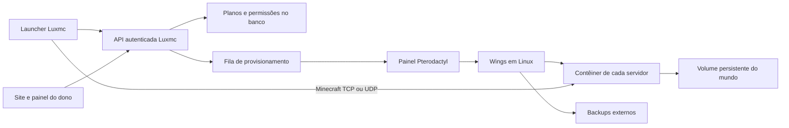

# Luxmc Worlds: implementação dos servidores

Proposta para a próxima etapa. A infraestrutura ainda não foi contratada e nenhum servidor hospedado foi provisionado nesta revisão.

## Como ficará para o jogador

O usuário abre **Servidores → Criar mundo**, escolhe uma versão ou um modpack com pacote oficial de servidor, confere os recursos incluídos no plano e cria o servidor. O painel mostra a instalação, o endereço, o console, jogadores conectados, uso de recursos e backups. O botão Jogar usa uma instância compatível. O mundo continua funcionando com o launcher e o computador do jogador desligados.

Um pacote de cliente não serve automaticamente como pacote de servidor. Mods de interface, renderização e recursos do cliente precisam ser separados. A primeira lista de modpacks suportados deve ter instalações de servidor verificadas, em vez de prometer que qualquer ZIP executa em um servidor dedicado.

## Arquitetura proposta

A API valida o identificador permanente da conta e o plano no servidor. Usa a mesma identidade para contas Luxmc e contas Microsoft vinculadas. O launcher não pode enviar um campo Pro e ganhar recursos por conta própria. Cada ação de console, arquivo ou backup deve verificar a propriedade do servidor.

A aprovação Pix continua no painel do dono. A aprovação precisa gerar uma concessão de plano e uma operação de provisionamento idempotente. Repetir uma requisição não deve criar dois servidores nem conceder dois planos. A infraestrutura só entra na oferta comercial depois de existir capacidade reservada e um teste de restauração.

## Primeira máquina

Contratar uma máquina Linux KVM com Docker, boa capacidade por núcleo, SSD/NVMe, IPv4 público e proteção de rede do provedor. Preferir uma região próxima dos jogadores; medir a latência antes da escolha definitiva. Como ponto de partida para um piloto pequeno, avaliar 16–32 GB de RAM e reservar memória para o sistema, painel, instalação e backups. Isso é um dimensionamento inicial, não uma garantia de quantidade de servidores ou de jogadores.

Instalar uma versão estável suportada de Pterodactyl e Wings. Cada instância fica em um contêiner com limites de CPU, memória, disco e processos, um volume próprio e uma porta alocada. [Requisitos oficiais de Wings](https://docs.pterodactyl.io/v1/wings/installing), [isolamento de servidores](https://pterodactyl.io/). Não permitir contêiner privilegiado nem disponibilizar o socket Docker aos clientes. Guardar credenciais de administração somente no backend.

O site e a API podem continuar na Cloudflare. O jogo precisa de um nó que execute Minecraft. Usar DNS/SRV para apontar o endereço público ao nó e HTTPS para o painel. O proxy gratuito comum não protege tráfego Minecraft TCP/UDP; Spectrum possui disponibilidade e custos específicos. [Protocolos e planos](https://developers.cloudflare.com/spectrum/protocols-per-plan/), [limitações para Minecraft](https://developers.cloudflare.com/spectrum/reference/limitations/). Escolher proteção de rede do provedor no piloto, sem prometer a cobertura de um serviço que não foi contratado.

## Planos: primeiro medir, depois vender

| Proposta | Luxmc Plus | Luxmc Pro |
| --- | --- | --- |
| Servidores simultâneos no piloto | 1 | 1 |
| RAM inicial para teste | 2–4 GB | 6–8 GB |
| Uso pretendido | Vanilla/Paper e pacotes leves | Modpacks compatíveis, conforme teste |
| Backups | Diários, retenção limitada | Diários, mais retenção e cópias manuais |
| Disco | Cota pequena, definida no piloto | Cota maior, definida no piloto |
| Prioridade de instalação | Normal | Maior, sem retirar recursos de servidores ativos |

Os recursos são propostas. Número de jogadores, desempenho e preços precisam ser definidos depois de medir o modpack, distância dos jogadores, custo da máquina e proteção de rede. Trinta jogadores exigem ensaio de carga; uma sala LAN com capacidade para trinta não comprova um servidor dedicado com trinta jogadores.

O orçamento mensal deve incluir máquina, IPv4, disco, tráfego, backups externos, proteção de rede, margem para picos e manutenção. Não vender dezenas de mundos 24 horas por dia em uma máquina sem capacidade para eles. Definir também suspensão por fim do plano, prazo de conservação e exportação do mundo antes de qualquer remoção.

## Entrega por etapas

1. Contratar o nó e configurar DNS, firewall, TLS, monitoração, Docker, painel e Wings. Criar dois servidores privados de teste: um Vanilla/Paper e um modpack de servidor 1.20.1.
2. Implementar `hosted_servers`, `server_jobs` e `server_audit` no backend. Cada servidor tem proprietário, plano, recursos, versão, modpack, estado desejado e estado observado. A fila tem criação, instalação, início, parada, backup, restauração e suspensão.
3. Integrar a API do painel pelo backend. Criar, instalar e consultar com tentativas limitadas e identificadores idempotentes. O console usa acesso curto, autenticado e restrito ao servidor do usuário.
4. Implementar a área **Luxmc Worlds** no site e no launcher: criar, acompanhar instalação, iniciar, parar, ver console, jogadores, espaço e backups, e exportar o mundo. Reutilizar a verificação de compatibilidade da instância ao jogar.
5. Testar conexão externa, reinício do nó, limite de memória, modpack de servidor, cancelamento, perda de rede, tentativa de acesso por outra conta e expiração do plano. Restaurar um backup em uma instância vazia e verificar o mundo.
6. Abrir um piloto com poucos usuários e limites de capacidade. Só publicar a oferta hospedada depois da validação e dos custos reais.
